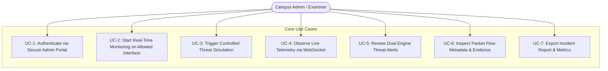

# Project Requirements Document (PRD)

**Project Name:** Campus Cybersecurity Threat Detection System  
**Document Version:** 1.0.0  
**Target Environment:** College Major Project / Academic & Lab Deployment  
**Project Classification:** Hybrid Intrusion Detection & Network Threat Telemetry System  

---

## 1. Executive Summary & Problem Statement

College and university campus networks present unique cybersecurity challenges:
1. **High Heterogeneity:** Thousands of BYOD (Bring Your Own Device) endpoints (smartphones, laptops, IoT lab equipment, unauthorized switches) access the campus intranet.
2. **Open Academic Culture vs. Security:** Unlike corporate intranets with locked-down devices and strict perimeter firewalls, campus networks prioritize open access for research, peer-to-peer collaboration, and guest networks.
3. **Bandwidth & Threat Exposure:** Academic institutions are frequent targets for Distributed Denial of Service (DDoS), credential brute-forcing, ARP poisoning, malware propagation, and internal rogue port scanning.
4. **Academic Project Constraints:** Commercial Security Information and Event Management (SIEM) systems (e.g., Splunk, IBM QRadar) and enterprise Intrusion Detection Systems (IDS) (e.g., Cisco Firepower) are prohibitively expensive, closed-source, and cannot be easily customized or inspected for educational research.

The **Campus Cybersecurity Threat Detection System** is designed as a modular, full-stack, hybrid threat detection platform tailored for college network administrators and academic evaluation. It combines **authorized real-time passive packet inspection** with a **safe traffic simulation engine**, utilizing a dual **rule-based + machine learning (Scikit-learn)** detection architecture to detect known signatures and statistical anomalies.

---

## 2. Project Scope & Operational Boundaries

### 2.1 In-Scope Capabilities
- **Hybrid Ingestion Pipeline:**
  - Real-time packet capture on authorized network interfaces (e.g., dedicated college lab subnet, TAP/SPAN mirror port, or local virtual adapter) using Python and Scapy.
  - Built-in synthetic traffic and cyberattack simulation generator (SYN floods, port sweeps, ARP anomalies, brute-force patterns) for safe testing without risking real campus infrastructure.
- **Dual Detection Engine:**
  - **Deterministic Rule Engine:** Real-time threshold, protocol validation, and signature-based detection for rapid response to known attack vectors.
  - **Machine Learning Engine:** Scikit-learn classification and anomaly detection models trained on standard network intrusion datasets (e.g., CIC-IDS2017 / NSL-KDD) augmented with synthesized campus traffic.
- **Centralized Admin Dashboard:**
  - Real-time WebSocket streaming of threat events, network throughput, and packet telemetry.
  - Interactive triage, alert classification, severity filtering, and packet flow inspection.
  - Model performance tracking (confusion matrix, precision/recall, ROC-AUC) and simulation control panel.
- **Role-Based Access Control:**
  - Single-tier, hardened administrative authentication using JWT (JSON Web Tokens) with password hashing (Argon2id/bcrypt).

### 2.2 Out-of-Scope (Non-Goals)
- Active Intrusion Prevention (IPS) that drops packets inline at the router/firewall level (to prevent unintended disruption of live campus internet during academic demonstrations).
- Deep packet inspection (DPI) of encrypted TLS/HTTPS payload contents (violates student privacy and legal wiretapping policies). Detection relies strictly on flow metadata, packet headers, and statistical characteristics.
- Multi-tenant enterprise ISP billing or identity provider integration (e.g., Active Directory / Shibboleth SAML federation).

---

## 3. User Personas & Use Cases

### 3.1 Primary Persona: Campus Network Administrator / Security Officer
- **Goal:** Monitor lab/campus network health, spot anomalous surges in traffic, identify compromised lab machines, and test security defenses safely.
- **Pain Point:** Lack of visibility into rogue devices and inability to run controlled attack scenarios during working hours.

### 3.2 Secondary Persona: Project Evaluator / Academic Examiner
- **Goal:** Verify that the system demonstrates both theoretical understanding (ML math, protocol internals) and practical implementation (FastAPI, WebSockets, React, Docker).
- **Need:** Repeatable, demonstrable attack scenarios with clear visualizations and measurable performance metrics.

### 3.3 Core Use Cases

---

## 4. Functional Requirements (FR)

### Module 1: Authentication & Admin Security
- **FR-1.1:** System shall provide an admin login screen protected with JSON Web Tokens (JWT) stored in secure HTTP-only cookies or authorization headers.
- **FR-1.2:** System shall enforce strong passwords (minimum 10 characters, alphanumeric with special symbols).
- **FR-1.3:** System shall log all admin actions (starting captures, firing simulations, acknowledging alerts) into a tamper-evident audit log table.
- **FR-1.4:** Session tokens shall expire after a configurable duration (default: 60 minutes) with token revocation support on logout.

### Module 2: Network Ingestion & Packet Processing
- **FR-2.1:** System shall bind to a specified network interface (Ethernet, Wi-Fi, loopback, or virtual switch) using Scapy in promiscuous/passive mode.
- **FR-2.2:** System shall support Berkeley Packet Filter (BPF) syntax (e.g., `tcp or udp`, `not port 22`) to isolate monitored traffic and minimize CPU overhead.
- **FR-2.3:** System shall extract flow-level bidirectional features (duration, source/destination IP, ports, flags, packet counts, byte counts, inter-arrival time).
- **FR-2.4:** System shall support switching between **Live Capture Mode**, **Simulation Mode**, and **Hybrid Mode** directly from the admin UI.

### Module 3: Threat Simulation Generator
- **FR-3.1:** System shall provide pre-configured attack profiles:
  - *TCP SYN Flood / Half-Open DDoS*
  - *Stealth TCP FIN / Xmas / Null Port Scans*
  - *DNS Query Flood / Tunneling Simulation*
  - *HTTP / SSH Credential Brute-Force Burst*
  - *ARP Poisoning / Gateway Spoofing Anomaly*
- **FR-3.2:** System shall enforce safe destination guards (simulations can ONLY target designated loopback addresses or designated target sandbox IPs).
- **FR-3.3:** System shall allow setting packet transmission rate (packets/sec) and duration (seconds) with an instantaneous emergency stop button.

### Module 4: Dual Detection Engine
- **FR-4.1 (Rule-Based Engine):**
  - Shall evaluate packets against deterministic YAML/JSON-defined signatures (e.g., port thresholds, SYN-to-ACK ratios, blacklisted malicious ports, invalid TCP flag combinations).
  - Processing latency per packet/flow must not exceed 5 milliseconds.
- **FR-4.2 (Machine Learning Engine):**
  - Shall extract 15+ statistical features from 5-second sliding flow windows.
  - Shall invoke pre-trained Scikit-learn pipelines (Random Forest Classifier for supervised multi-class attack detection; Isolation Forest for zero-day anomaly detection).
  - Model inference latency per flow window must not exceed 50 milliseconds.
- **FR-4.3 (Correlation & Severity Scorer):**
  - Shall aggregate outputs from both engines into a unified threat confidence score (0.0 to 1.0) and categorize alerts into `LOW`, `MEDIUM`, `HIGH`, `CRITICAL`.

### Module 5: Real-Time Telemetry & Alert Triage
- **FR-5.1:** System shall establish a WebSocket connection with the React frontend to push:
  - Bandwidth/Throughput time-series data (KB/s, packets/s).
  - Live alerts as soon as an anomaly or signature match occurs.
  - Active capture status and simulation execution state.
- **FR-5.2:** Dashboard shall allow filtering alerts by severity, source IP, attack category, and status (`Active`, `Investigating`, `Resolved`, `False Positive`).
- **FR-5.3:** System shall provide interactive Recharts visualizations:
  - Protocol breakdown (TCP vs UDP vs ICMP vs Other pie/donut chart).
  - Traffic volume area chart (last 10 minutes sliding window).
  - Threat distribution bar chart (Attack Types vs Occurrences).
  - Top 5 offending source IP addresses.

---

## 5. Non-Functional Requirements (NFR)

### 5.1 Performance & Scalability
- **NFR-1.1 (Throughput):** The capture daemon must comfortably process up to 2,000 packets per second (typical 100 Mbps - 1 Gbps departmental lab traffic) on standard 4-core college workstation hardware without dropping more than 1% of packets.
- **NFR-1.2 (Dashboard Latency):** WebSocket telemetry update interval shall be throttled to 1,000ms batch windows to avoid React rendering lockups and browser memory exhaustion.
- **NFR-1.3 (Database Storage Efficiency):** Raw packet payloads shall NOT be stored in PostgreSQL. Only flow summaries and triggered alert metadata are stored to ensure database size remains manageable over weeks of testing.

### 5.2 Security, Privacy & Compliance
- **NFR-2.1 (Student & Staff Privacy):** The packet parser must automatically discard Layer 7 payload bytes for unflagged traffic.
- **NFR-2.2 (IP Anonymization Option):** Support configurable IP subnet masking (e.g., zeroing out the last octet `192.168.1.xxx`) for student privacy compliance during demonstrations.
- **NFR-2.3 (Least Privilege Execution):** If packet sniffing requires elevated OS capabilities (`CAP_NET_RAW`, `CAP_NET_ADMIN` in Linux or WinPcap/Npcap administrator on Windows), the capture module shall run as an isolated background worker service, keeping the web API in unprivileged mode.
- **NFR-2.4 (Injection Defense):** All SQL interactions must use SQLAlchemy ORM with parameterized queries. All user inputs in rules and configurations must be validated using Pydantic.

### 5.3 Reliability & Availability
- **NFR-3.1:** If the live capture interface disconnects or experiences a socket buffer overrun, the backend shall log a critical error and keep the web dashboard functional.
- **NFR-3.2:** System components must be packaged as Docker containers (`docker-compose.yml`) for one-click setup on examiner machines.

---

## 6. Assumptions and Dependencies

1. **Host Environment:** Windows 10/11 or Ubuntu 22.04 LTS host with Npcap (Windows) or `libpcap` (Linux) installed for raw packet capture.
2. **Network Topology:** Monitored traffic is confined to an authorized research lab subnet, a local loopback environment, or a router mirror port (SPAN) configured by campus network authorities.
3. **Hardware Baseline:** Standard student/lab PC (Intel Core i5 / AMD Ryzen 5, 8GB RAM, 20GB free storage). No GPU is required since Scikit-learn CPU inference is lightweight.
4. **Target Dataset Baseline:** Models will be trained using sanitized extracts from standard IDS datasets (CIC-IDS2017 / NSL-KDD) supplemented by synthetic samples generated by the simulation module.
