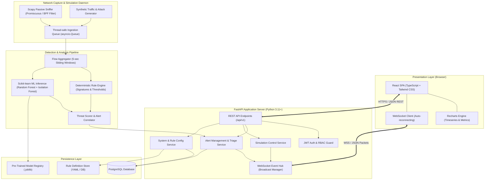
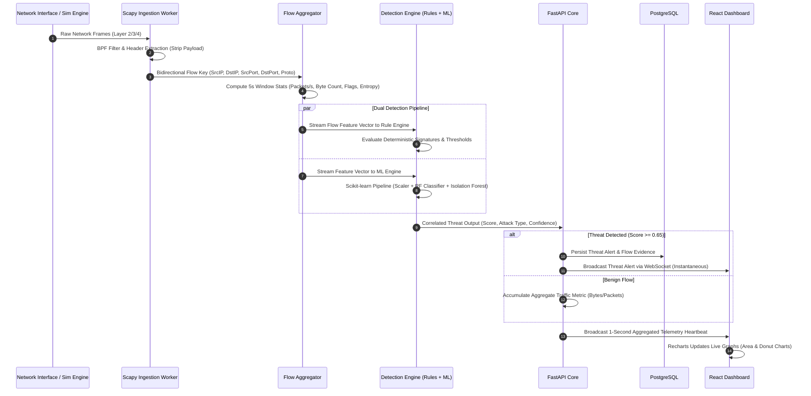
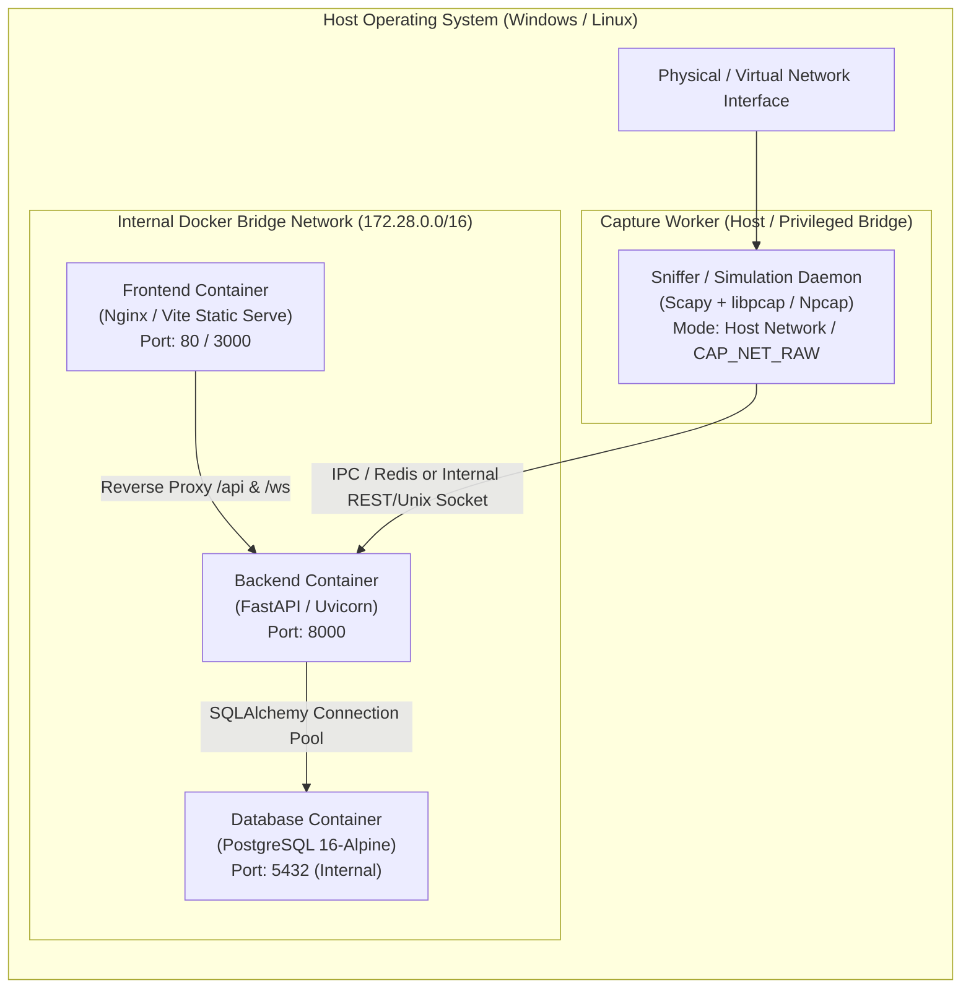

# System Architecture Document

**Project Name:** Campus Cybersecurity Threat Detection System  
**Document Version:** 1.0.0  
**Architectural Style:** Layered Service Architecture with Event-Driven Real-Time Streaming  

---

## 1. High-Level Architectural Overview

The Campus Cybersecurity Threat Detection System is organized into four distinct operational layers:
1. **Network Ingestion & Simulation Layer (Edge Worker):** Captures authorized campus network frames via Scapy and generates controlled synthetic attack flows.
2. **Analysis & Dual-Detection Core (Pipeline Engine):** Performs high-throughput packet parsing, sliding-window flow aggregation, deterministic rule evaluation, and ML statistical anomaly classification.
3. **Application & State Management Layer (FastAPI Backend + PostgreSQL):** Exposes secure REST endpoints, manages alert state and historical metrics, handles JWT authentication, and pushes real-time events over WebSockets.
4. **Presentation & Triage Layer (React + Vite + Tailwind CSS + Recharts):** Provides a single-pane-of-glass administrative dashboard with live telemetry graphs, alert triage workflows, and simulation controls.

---

## 2. Component & Container Diagram

---

## 3. Detailed Data Flow Architecture

The end-to-end data lifecycle traverses six distinct stages:

### 3.1 Stage-by-Stage Breakdown

1. **Packet Capture Stage:**
   - Scapy binds to the selected interface with BPF filter (e.g., `ip and (tcp or udp or icmp)`).
   - Packet headers are dissected into source IP, destination IP, transport protocol, ports, length, TCP flags, and timestamp.
   - **Privacy Guard:** Application layer payloads (HTTP POST bodies, raw TLS handshakes) are pruned immediately in memory.

2. **Flow Aggregation Stage:**
   - Packets are hashed into bidirectional flow tuples: `(min(SrcIP, DstIP), max(SrcIP, DstIP), min(Port, Port), max(Port, Port), Protocol)`.
   - Metrics are computed over dynamic sliding windows (5 seconds default):
     - Forward/Backward packet count & byte volume.
     - SYN, ACK, FIN, RST, PSH flag ratios.
     - Inter-arrival packet time variance.
     - Unique destination port count per source IP (scan detection).

3. **Dual Detection Stage:**
   - **Branch A (Rule Engine):** Evaluates instantaneous anomalies (e.g., SYN flag without ACK > 50 pkts/s; access to prohibited ports like 4444, 1337; ARP spoofing duplicate IP mappings).
   - **Branch B (ML Engine):** Feeds the normalized 18-dimensional feature vector into:
     - *Random Forest Classifier:* Multi-class identification (DDoS, PortScan, BruteForce, Benign).
     - *Isolation Forest:* Anomaly score identifying novel deviating patterns.

4. **Alert Correlation & Scoring Stage:**
   - Combines findings into a normalized threat score $S \in [0.0, 1.0]$.
   - If both engines agree, confidence is weighted to $1.0$.
   - Alerts with $S \ge 0.65$ trigger persistent storage in PostgreSQL and real-time push notification.

5. **Broadcast & Visualization Stage:**
   - The FastAPI WebSocket Connection Manager publishes lightweight JSON frames to all connected, authenticated admin dashboard instances.
   - The React frontend buffers telemetry in a bounded ring-buffer (maximum 60 data points) to prevent browser rendering lag.

---

## 4. Deployment & Infrastructure Architecture

The system is deployed using **Docker Compose** to guarantee environment parity across developer workstations, university evaluation laptops, and lab servers.

### 4.1 Container Responsibilities

| Container Service | Base Image | Role & Privileges | Exposed Ports |
| :--- | :--- | :--- | :--- |
| **`campus-frontend`** | `node:20-alpine` (builder) / `nginx:alpine` | Static HTML5/React UI serving, reverse proxy for WebSocket and REST API | `80` (or `3000`) |
| **`campus-backend`** | `python:3.11-slim` | FastAPI application, ML inference, WebSocket manager, REST controllers | `8000` |
| **`campus-database`** | `postgres:16-alpine` | Persistent storage for users, rules, alerts, flow telemetry summaries | `5432` (internal) |
| **`campus-sniffer`** | `python:3.11-slim` | Scapy packet ingestion and attack simulation (requires `net: host` or `CAP_NET_RAW` / `CAP_NET_ADMIN` capabilities) | None (communicates via internal queue/socket) |

> [!NOTE]
> On Windows development environments, the sniffer and backend can run combined in a single Python process or via Docker Desktop using Windows Npcap bridging. For production Linux deployment, containerizing with `cap_add: [NET_RAW, NET_ADMIN]` provides complete privilege isolation.

---

## 5. Architectural Quality Attributes & Design Decisions

### 5.1 Decoupling Capture from API Serving
- **Design Decision:** The Scapy capture loop executes in an independent thread/process using `asyncio` queues, communicating with FastAPI via internal async workers.
- **Rationale:** Scapy packet sniffing is synchronous and CPU-bound at high packet rates. Isolating it prevents blocking FastAPI’s event loop, ensuring the web dashboard and WebSockets remain responsive under heavy attack traffic.

### 5.2 Flow Aggregation vs. Raw Packet Logging
- **Design Decision:** Discard raw packets after computing 5-second flow statistics; only store metadata for packets triggering an alert.
- **Rationale:** Capturing full packet payloads at 100 Mbps would generate gigabytes of data within minutes, causing disk exhaustion on college lab workstations and violating student data privacy.

### 5.3 Stateless Authentication with JWT
- **Design Decision:** Authenticate admin sessions via cryptographically signed JWT tokens (HMAC-SHA256).
- **Rationale:** Simplifies WebSocket authorization during initial handshake query parameters or headers without requiring heavy distributed session stores like Redis.
