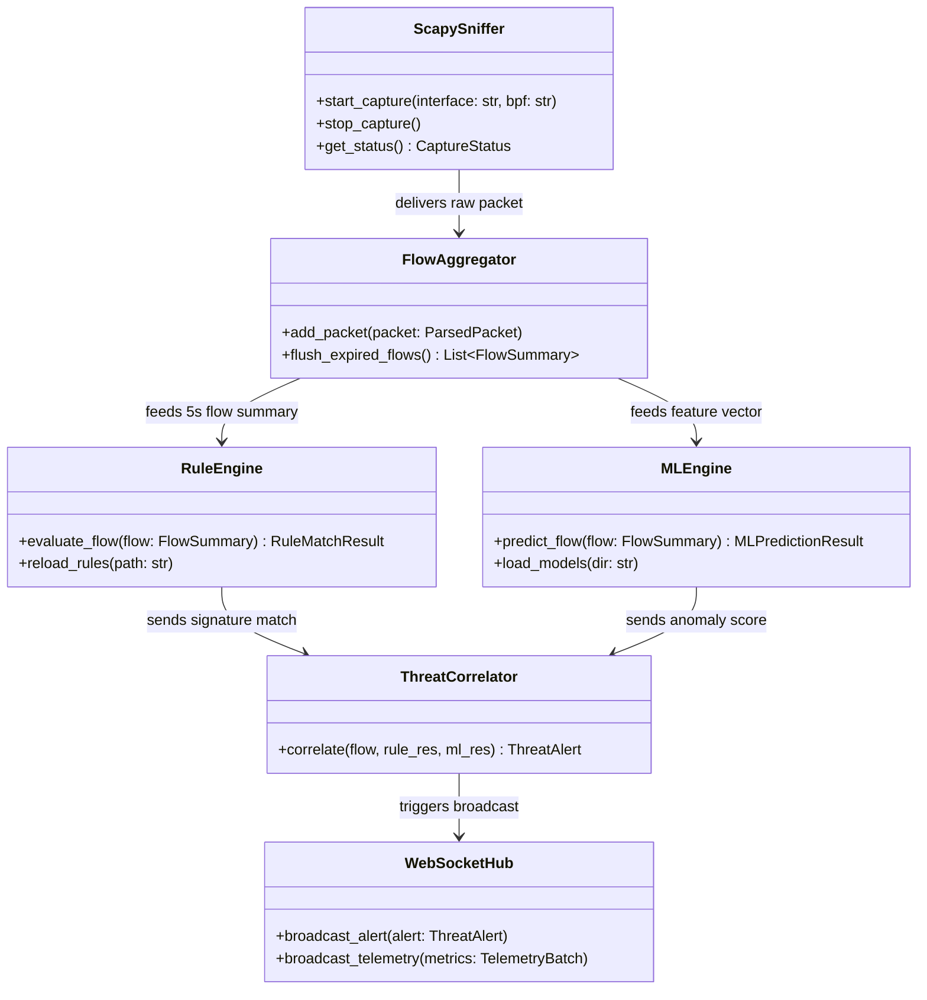

# Application Modules Specification

**Project Name:** Campus Cybersecurity Threat Detection System  
**Document Version:** 1.0.0  
**Scope:** Structural and Functional Breakdown of Backend and Frontend Codebases  

---

## 1. Modular Directory Structure Overview

The project is structured as a modern, decoupled monorepo separating the FastAPI backend, React frontend, and shared configuration.

```
campus-cybersecurity-system/
├── backend/
│   ├── app/
│   │   ├── api/                  # REST API Endpoints & Routers
│   │   ├── core/                 # App Config, Security, DB Sessions, Base Logging
│   │   ├── db/                   # SQLAlchemy Models, Migrations (Alembic)
│   │   ├── detection/            # Dual Detection Engine
│   │   │   ├── rules/            # Deterministic Rule Engine & YAML Signatures
│   │   │   ├── ml/               # Feature Extraction, Model Loader & Inference
│   │   │   └── correlator/       # Threat Scorer & Deduplication Engine
│   │   ├── ingestion/            # Scapy Sniffer, Packet Dissector, BPF Filter
│   │   ├── simulation/           # Synthetic Attack & Benign Traffic Generator
│   │   ├── schemas/              # Pydantic Request/Response DTOs
│   │   ├── services/             # Business Logic & DB Transactions
│   │   └── websocket/            # Real-time WebSocket Hub & Broadcast Manager
│   ├── models/                   # Pre-trained Scikit-learn Model Weights (.joblib)
│   ├── rules/                    # Default Signature Files (signatures.yaml)
│   └── tests/                    # Backend Unit & Integration Tests
├── frontend/
│   ├── src/
│   │   ├── assets/               # Static Logos & Icons
│   │   ├── components/           # Reusable UI Components
│   │   │   ├── alerts/           # Alert Table, Severity Badges, Inspection Modal
│   │   │   ├── charts/           # Recharts Visualizations (Area, Bar, Donut)
│   │   │   ├── common/           # Cards, Modals, Buttons, Navbars, Status Pills
│   │   │   ├── layout/           # Sidebar, Header, Breadcrumbs, Admin Shell
│   │   │   └── simulation/       # Simulation Controls, Sliders, Emergency Stop
│   │   ├── context/              # AuthContext & WebSocketContext Providers
│   │   ├── hooks/                # Custom Hooks (useWebSocket, useMetrics, useAlerts)
│   │   ├── pages/                # Routed Views (Dashboard, Alerts, Rules, Sim, Settings)
│   │   ├── services/             # Axios/Fetch API Clients
│   │   └── types/                # TypeScript Interfaces & Contract Definitions
│   └── tests/                    # Frontend Component Tests
├── docker/                       # Dockerfiles & Compose Orchestration
└── docs/                         # Architecture, Requirements, and Setup Docs
```

---

## 2. Backend Modules Breakdown (FastAPI)

### 2.1 Core Module (`backend/app/core/`)
- **`config.py`:** Reads environment variables using `pydantic-settings` (Database URL, JWT secret key, token expiration, capture interface, logging level).
- **`security.py`:** Implements password hashing using `passlib` (Argon2id/bcrypt) and JWT encoding/decoding functions via `python-jose`.
- **`database.py`:** Initializes SQLAlchemy async/sync engine, declarative base, and session lifecycle dependency (`get_db`).
- **`logging.py`:** Configures structured JSON logging with log rotation to avoid disk saturation during high-packet capture events.

### 2.2 Ingestion Module (`backend/app/ingestion/`)
- **`sniffer.py`:**
  - Wraps Scapy’s `AsyncSniffer` or socket loop in a dedicated background worker thread.
  - Applies user-defined BPF filters (e.g., `ip and not port 8000 and not port 5432`).
  - Supports switching between live network interfaces and loopback.
- **`dissector.py`:**
  - Unpacks raw packets into high-level Python dataclasses (`ParsedPacket`).
  - Extracts Layer 3 (IPv4/IPv6, TTL, Length) and Layer 4 (TCP flags, ports, sequence numbers, UDP length, ICMP types).
  - Sanitizes/strips Layer 7 payload data to guarantee student privacy.
- **`flow_aggregator.py`:**
  - Maintains in-memory bidirectional flow table with timestamped sliding windows (default 5.0 seconds).
  - Calculates flow-level statistical metrics: forward/backward packet counts, byte volumes, packet size variance, duration, and flag counts.
  - Evicts stale flows periodically to keep memory bounded.

### 2.3 Simulation Module (`backend/app/simulation/`)
- **`traffic_generator.py`:** Coordinates attack scenarios using Scapy packet crafting.
- **Attack Sub-modules:**
  - `syn_flood.py`: Generates rapid TCP SYN bursts with randomized source ports and dummy sequence numbers.
  - `port_scanner.py`: Simulates horizontal (single port across multiple IPs) and vertical (multiple ports on a single host) stealth scans (SYN, FIN, NULL, Xmas).
  - `dns_tunnel.py`: Generates repetitive high-entropy DNS TXT/A queries mimicking data exfiltration.
  - `brute_force.py`: Emulates rapid credential brute-forcing bursts against SSH (port 22) or HTTP auth endpoints.
  - `benign_generator.py`: Generates realistic background HTTP/HTTPS and DNS traffic to prevent ML false alarms.
- **`guardrails.py`:**
  - Validates all simulation parameters against strict security constraints.
  - Blocks simulations targeting external internet IP addresses; restricts execution to designated loopback (`127.0.0.1`), Docker bridge (`172.x.x.x`), or approved lab subnets (`192.168.x.x`).
  - Includes an atomic `abort_event` flag for immediate execution cancellation.

### 2.4 Detection Engine (`backend/app/detection/`)
- **Rule Engine (`detection/rules/`):**
  - `rule_loader.py`: Parses declarative signatures from `rules/signatures.yaml`.
  - `evaluator.py`: Matches incoming flows against deterministic conditions:
    - SYN-to-ACK ratio $> 5:1$ with packet rate $> 100 \text{ pkts/sec}$ (SYN flood).
    - Single source IP querying $> 20$ closed ports within 3 seconds (Port scan).
    - Unmatched TCP flag combinations (e.g., SYN+FIN or NULL flags).
    - Malicious port activity (known Trojan/backdoor ports: 4444, 31337, 5555).
- **Machine Learning Engine (`detection/ml/`):**
  - `feature_extractor.py`: Converts flow statistics into a 18-element numerical feature vector matching the model's training schema.
  - `preprocessor.py`: Applies pre-fitted `StandardScaler` transformations.
  - `model_registry.py`: Loads serialized `.joblib` model weights into memory at startup.
  - `inference.py`: Runs dual predictions:
    1. *Random Forest Classifier:* Returns predicted attack class and softmax probability.
    2. *Isolation Forest:* Returns anomaly score between $[-1.0, 1.0]$.
- **Threat Correlator (`detection/correlator/`):**
  - `scorer.py`: Combines rule hits and ML anomaly scores into a normalized threat index:
    $$\text{Final Threat Score} = w_r \cdot S_{\text{rule}} + w_m \cdot S_{\text{ML}}$$
  - `deduplicator.py`: Suppresses duplicate alert spam for ongoing persistent attacks (e.g., aggregating 1,000 SYN packets into a single incident with an update counter).

### 2.5 Real-Time Communication (`backend/app/websocket/`)
- **`manager.py`:** Manages active WebSocket connections from authenticated browser clients.
- **`broadcaster.py`:**
  - Batches system health and throughput metrics every 1,000ms.
  - Dispatches immediate high-priority alerts when severe threats ($S \ge 0.65$) are detected.
  - Sends heartbeat `PING/PONG` frames to detect disconnected clients.

### 2.6 Persistence & API Layer (`backend/app/api/` & `services/`)
- **Routers:**
  - `/auth`: Login, token refresh, current user profile.
  - `/dashboard`: Overall metrics, protocol distribution, threat counts.
  - `/alerts`: Paginated alert queries, detail view, status update (Acknowledge, Resolve, False Positive).
  - `/simulation`: Start simulation, abort simulation, query available profiles and current state.
  - `/rules`: View, enable/disable, and tune threshold parameters.
  - `/system`: Interface selection, capture start/stop, sniffer health status.

---

## 3. Frontend Modules Breakdown (React + TypeScript)

### 3.1 Authentication & Shell Layout (`frontend/src/`)
- **`pages/LoginPage.tsx`:** Clean, focused administrative login form with validation, error banners, and JWT session initiation.
- **`components/layout/AppLayout.tsx`:** Persistent administrative shell with responsive collapsible sidebar, system connection pill (Live / Offline / Simulating), active user badge, and logout trigger.
- **`context/AuthContext.tsx`:** Manages JWT storage, auto-logout on 401 Unauthorized, and session restoration.
- **`context/WebSocketContext.tsx`:** Establishes resilient WebSocket connection with exponential backoff auto-reconnect, providing live streams to consuming views.

### 3.2 Dashboard & Visualization Module (`frontend/src/pages/DashboardPage.tsx`)
- **Summary Stat Cards:**
  - Active Threat Count (Critical / High / Medium / Low).
  - Current Network Ingestion Rate (Packets/sec, KB/sec).
  - Total Inspected Flows.
  - System Capture Mode (Live / Simulation / Idle).
- **Interactive Recharts Components (`components/charts/`):**
  - `ThroughputAreaChart.tsx`: Live dual-area graph displaying incoming vs outgoing traffic volume over a 60-second sliding timeline.
  - `ProtocolDonutChart.tsx`: Real-time breakdown of protocols (TCP, UDP, ICMP, DNS).
  - `ThreatBarChart.tsx`: Bar chart displaying frequency of detected threat categories (DDoS, Scans, BruteForce, Anomalies).
  - `TopOffendersList.tsx`: Tabular badge list of the top 5 source IPs generating threat alerts.

### 3.3 Threat Alert Triage Module (`frontend/src/pages/AlertsPage.tsx`)
- **`AlertTable.tsx`:** Interactive data table featuring:
  - Severity color pill (`CRITICAL` = Red, `HIGH` = Orange, `MEDIUM` = Yellow, `LOW` = Blue).
  - Detection source tag (`Rule-Based`, `ML-Anomaly`, `Hybrid Correlation`).
  - Source IP / Destination IP / Port info.
  - Timestamp with humanized relative time ("3s ago").
- **`AlertDetailModal.tsx`:**
  - Shows extracted flow features (SYN count, packet rate, duration).
  - Displays ML model confidence percentage and matching rule details.
  - Action buttons: "Mark as Investigating", "Resolve Incident", "Mark as False Positive".

### 3.4 Threat Simulation Control Panel (`frontend/src/pages/SimulationPage.tsx`)
- **`SimulationLauncher.tsx`:**
  - Card selector for attack profiles (SYN Flood, Port Scan, DNS Tunnel, Brute Force).
  - Safety config form: Target IP (locked to allowed sandboxes), packet rate slider (10 to 500 pkts/s), duration slider (5 to 60 seconds).
  - Interactive "Launch Simulation" button with confirmation modal.
- **`ActiveSimulationBanner.tsx`:**
  - Displays countdown timer, progress bar, and animated pulse indicator while simulation is running.
  - Prominent red "EMERGENCY STOP" button to instantly halt packet generation.

### 3.5 System & Rule Configuration (`frontend/src/pages/RulesPage.tsx`)
- **`RuleEditor.tsx`:**
  - Displays list of active deterministic detection rules.
  - Inline toggles to enable or disable individual rules without restarting the server.
  - Sliders to adjust sensitivity thresholds (e.g., adjusting port scan threshold from 20 to 15 ports/sec).

---

## 4. Module Inter-Communication & Interface Contracts


