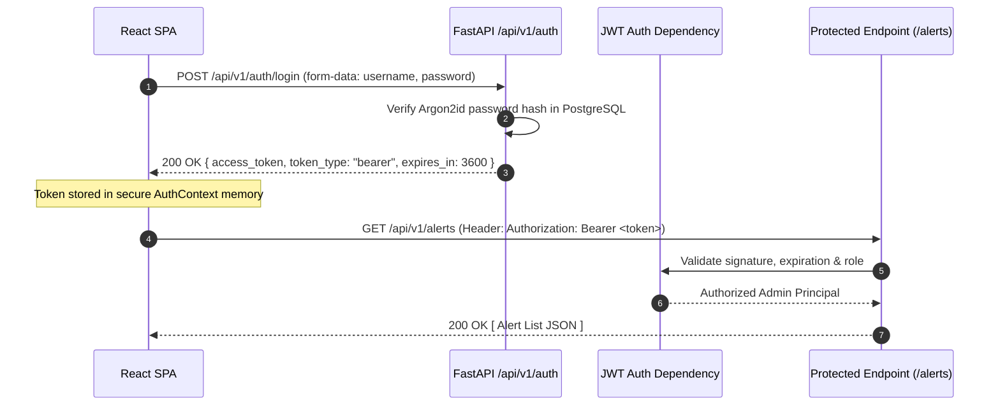

# API Architecture & Contract Specification

**Project Name:** Campus Cybersecurity Threat Detection System  
**Document Version:** 1.0.0  
**API Protocol:** REST (HTTP/2 or HTTP/1.1 over TLS) + WebSockets  
**Base URL:** `/api/v1`  
**Schema Standard:** OpenAPI 3.1 via FastAPI  

---

## 1. Authentication & Security Flow

All API endpoints (except `/api/v1/auth/login`) require a signed JSON Web Token (JWT) supplied in the `Authorization` header:

```http
Authorization: Bearer <JWT_ACCESS_TOKEN>
```



---

## 2. REST Endpoint Catalog

### 2.1 Authentication Endpoints (`/api/v1/auth`)

#### `POST /api/v1/auth/login`
Authenticates the administrator and issues a JWT token.
- **Request Body (application/x-www-form-urlencoded):**
  ```json
  {
    "username": "admin",
    "password": "Secur3Password!"
  }
  ```
- **Response `200 OK`:**
  ```json
  {
    "access_token": "eyJhbGciOiJIUzI1NiIsIn...",
    "token_type": "bearer",
    "expires_in": 3600,
    "user": {
      "id": "e9b11927-2c97-4c4b-b0b3-90d1bf373a21",
      "username": "admin",
      "role": "admin"
    }
  }
  ```
- **Error `401 Unauthorized`:** `{ "detail": "Incorrect username or password" }`

#### `GET /api/v1/auth/me`
Retrieves the profile and permissions of the currently authenticated administrator.
- **Response `200 OK`:**
  ```json
  {
    "id": "e9b11927-2c97-4c4b-b0b3-90d1bf373a21",
    "username": "admin",
    "email": "netsec-admin@campus.edu",
    "role": "admin",
    "last_login_at": "2026-11-02T18:45:00Z"
  }
  ```

---

### 2.2 Dashboard & Telemetry Endpoints (`/api/v1/dashboard`)

#### `GET /api/v1/dashboard/stats`
Returns aggregated summary statistics for the top-level KPI cards.
- **Response `200 OK`:**
  ```json
  {
    "active_threats_count": 7,
    "critical_threats_count": 2,
    "total_inspected_packets": 1425890,
    "current_packet_rate": 342.5,
    "current_bandwidth_kbps": 2180.4,
    "active_capture_mode": "LIVE_AUTHORIZED",
    "active_interface": "eth0"
  }
  ```

#### `GET /api/v1/dashboard/history`
Retrieves time-series data for the dashboard charts over a specified window.
- **Query Parameters:** `window` (`15m`, `1h`, `24h`)
- **Response `200 OK`:**
  ```json
  {
    "timestamps": ["2026-11-02T19:00:00Z", "2026-11-02T19:01:00Z"],
    "packet_rates": [320, 450],
    "bandwidth_kbps": [1980.2, 2800.5],
    "protocol_distribution": {
      "TCP": 78.4,
      "UDP": 16.2,
      "ICMP": 3.8,
      "DNS": 1.6
    }
  }
  ```

---

### 2.3 Threat Alert Management Endpoints (`/api/v1/alerts`)

#### `GET /api/v1/alerts`
Paginated search and filter for detected security incidents.
- **Query Parameters:**
  - `page`: integer (default: 1)
  - `limit`: integer (default: 20, max: 100)
  - `severity`: string (`CRITICAL`, `HIGH`, `MEDIUM`, `LOW`)
  - `status`: string (`ACTIVE`, `INVESTIGATING`, `RESOLVED`, `FALSE_POSITIVE`)
  - `search`: string (filters by IP address or attack name)
- **Response `200 OK`:**
  ```json
  {
    "total": 42,
    "page": 1,
    "limit": 20,
    "items": [
      {
        "id": "c1f728db-0d5b-4394-a131-0df8e8a939f5",
        "attack_type": "TCP SYN Flood",
        "severity": "CRITICAL",
        "detection_source": "HYBRID",
        "confidence_score": 0.98,
        "source_ip": "192.168.10.145",
        "destination_ip": "192.168.10.1",
        "source_port": 49210,
        "destination_port": 80,
        "protocol": "TCP",
        "status": "ACTIVE",
        "created_at": "2026-11-02T19:15:32Z"
      }
    ]
  }
  ```

#### `GET /api/v1/alerts/{id}`
Returns granular flow features and evidence for a specific incident.
- **Response `200 OK`:**
  ```json
  {
    "id": "c1f728db-0d5b-4394-a131-0df8e8a939f5",
    "attack_type": "TCP SYN Flood",
    "severity": "CRITICAL",
    "confidence_score": 0.98,
    "evidence": {
      "packet_count": 1250,
      "duration_seconds": 4.8,
      "packet_rate": 260.4,
      "syn_count": 1248,
      "ack_count": 2,
      "rst_count": 0,
      "ml_probability": 0.965,
      "matching_rule": "RULE-DOS-SYNFLOOD-01"
    }
  }
  ```

#### `PATCH /api/v1/alerts/{id}/status`
Updates the triage status of an alert.
- **Request Body:**
  ```json
  {
    "status": "RESOLVED",
    "notes": "Isolated lab workstation port 14 on switch SW-LAB-02."
  }
  ```
- **Response `200 OK`:** `{ "message": "Alert status updated successfully" }`

---

### 2.4 Simulation Engine Endpoints (`/api/v1/simulation`)

#### `GET /api/v1/simulation/profiles`
Returns pre-configured attack simulation templates.
- **Response `200 OK`:**
  ```json
  [
    {
      "id": "SYN_FLOOD",
      "name": "TCP Half-Open SYN Flood",
      "description": "Floods target port with SYN packets without completing handshake",
      "allowed_targets": ["127.0.0.1", "192.168.50.0/24"],
      "default_packet_rate": 100,
      "default_duration_sec": 15
    },
    {
      "id": "PORT_SCAN",
      "name": "Stealth TCP SYN Port Sweep",
      "description": "Rapidly scans top 100 ports on target host",
      "allowed_targets": ["127.0.0.1", "192.168.50.0/24"],
      "default_packet_rate": 50,
      "default_duration_sec": 10
    }
  ]
  ```

#### `POST /api/v1/simulation/start`
Initiates a controlled attack simulation within allowed boundaries.
- **Request Body:**
  ```json
  {
    "attack_type": "SYN_FLOOD",
    "target_ip": "127.0.0.1",
    "target_port": 80,
    "packet_rate": 150,
    "duration_seconds": 10
  }
  ```
- **Response `202 Accepted`:**
  ```json
  {
    "simulation_run_id": "a901844b-b230-43f1-b924-d2e8bcf82e91",
    "status": "RUNNING",
    "message": "Simulation started successfully"
  }
  ```
- **Error `400 Bad Request`:**
  ```json
  { "detail": "Security Guardrail Violation: Target IP 8.8.8.8 is outside authorized campus test subnets." }
  ```

#### `POST /api/v1/simulation/stop`
Instantly triggers the emergency abort mechanism for any running simulation.
- **Response `200 OK`:** `{ "status": "ABORTED", "message": "Simulation execution terminated" }`

---

### 2.5 System & Sniffer Control (`/api/v1/system`)

#### `GET /api/v1/system/interfaces`
Lists available network interfaces on the host server.
- **Response `200 OK`:**
  ```json
  [
    { "name": "eth0", "description": "Intel Ethernet Connection", "ip": "192.168.1.100", "is_up": true },
    { "name": "lo", "description": "Software Loopback Interface", "ip": "127.0.0.1", "is_up": true }
  ]
  ```

#### `POST /api/v1/system/capture/start`
Starts packet sniffing on the selected interface.
- **Request Body:**
  ```json
  {
    "interface": "eth0",
    "bpf_filter": "ip and not port 8000 and not port 5432"
  }
  ```
- **Response `200 OK`:** `{ "status": "CAPTURING", "interface": "eth0" }`

---

## 3. WebSocket Real-Time Telemetry Specification

### 3.1 Connection Protocol & Handshake
- **URL:** `ws://<host>:<port>/api/v1/ws/telemetry?token=<JWT_TOKEN>`
- **Handshake Authentication:** The token is validated during the HTTP Upgrade phase. Invalid or expired tokens return HTTP `403 Forbidden` before WebSocket establishment.

### 3.2 Downlink Message Schemas (Server → Client)

#### Event 1: Aggregated Telemetry Heartbeat (`TELEMETRY_HEARTBEAT`)
Pushed every 1,000ms:
```json
{
  "type": "TELEMETRY_HEARTBEAT",
  "timestamp": 1730554800.125,
  "payload": {
    "packet_rate": 312,
    "byte_rate_kbps": 1845.6,
    "active_flows": 48,
    "protocols": { "TCP": 82, "UDP": 14, "ICMP": 4 }
  }
}
```

#### Event 2: Immediate Threat Alert (`THREAT_ALERT`)
Pushed instantaneously when a threat is identified:
```json
{
  "type": "THREAT_ALERT",
  "timestamp": 1730554802.450,
  "payload": {
    "id": "c1f728db-0d5b-4394-a131-0df8e8a939f5",
    "attack_type": "TCP SYN Flood",
    "severity": "CRITICAL",
    "detection_source": "HYBRID",
    "confidence_score": 0.98,
    "source_ip": "192.168.10.145",
    "destination_ip": "192.168.10.1",
    "destination_port": 80
  }
}
```

#### Event 3: Simulation State Progress (`SIMULATION_PROGRESS`)
Pushed during simulation execution:
```json
{
  "type": "SIMULATION_PROGRESS",
  "payload": {
    "run_id": "a901844b-b230-43f1-b924-d2e8bcf82e91",
    "status": "RUNNING",
    "packets_sent": 750,
    "elapsed_seconds": 5,
    "total_seconds": 10
  }
}
```

### 3.3 Uplink Message Schemas (Client → Server)
Clients can send heartbeat pings or filter preference updates:
```json
{ "type": "PING", "timestamp": 1730554800.000 }
```
Server responds with:
```json
{ "type": "PONG", "timestamp": 1730554800.005 }
```
