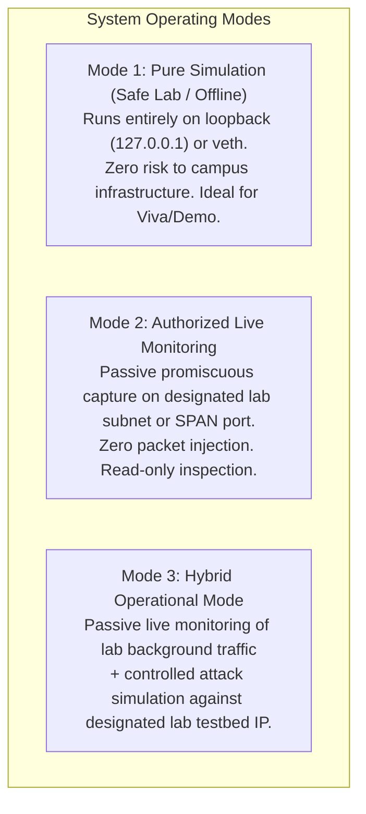
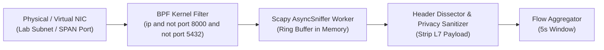
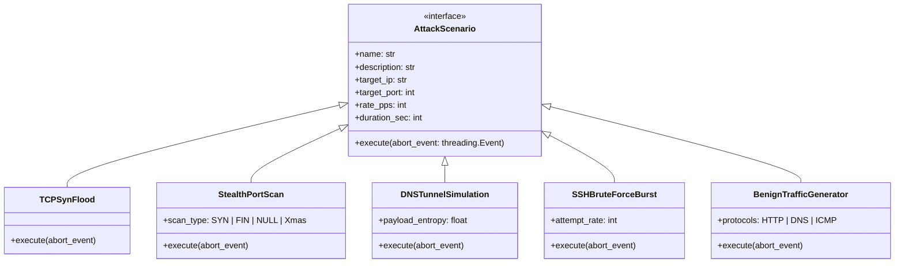
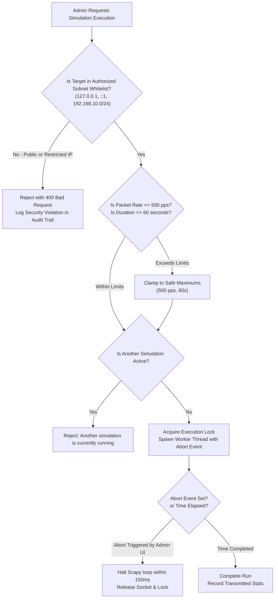

# Network Monitoring & Traffic Simulation Specification

**Project Name:** Campus Cybersecurity Threat Detection System  
**Document Version:** 1.0.0  
**Core Technologies:** Python, Scapy, Npcap / libpcap, Berkeley Packet Filters (BPF)  

---

## 1. Operating Modes Architecture

The system supports three distinct operational modes, selectable directly from the administrative dashboard:



---

## 2. Authorized Real-Time Campus Network Monitoring

### 2.1 Sniffing Mechanism & Architecture
Real-time packet capture is implemented using Scapy’s `AsyncSniffer` operating over a native `libpcap` (Linux) or `Npcap` (Windows) driver.



### 2.2 Berkeley Packet Filter (BPF) Optimization
To avoid saturating the Python process and prevent self-monitoring loops (sniffing our own API or database traffic), the sniffer compiles kernel-level BPF filter strings before capturing:

```text
ip and not (port 8000 or port 5432 or port 3000) and not (dst host 127.0.0.1 and port 8000)
```
- **Filter Breakdown:**
  - `ip`: Limits capture to IPv4/IPv6 packets (filters out noisy raw Ethernet discovery frames like STP or LLDP unless explicitly needed).
  - `not (port 8000 or port 5432 or port 3000)`: Strictly ignores communication between the React frontend, FastAPI backend, and PostgreSQL database.
  - Ensures negligible CPU overhead by dropping irrelevant frames inside the OS kernel before context-switching into Python user-space.

### 2.3 Legal, Ethical & Privacy Safeguards
1. **Administrative Consent Protocol:**
   - Real-time monitoring must only be activated on network segments where explicit authorization has been granted by the College Network Administrator or Department Head (e.g., Department Computer Lab, Cybersecurity Research Testbed).
2. **Payload Stripping (Zero L7 Data Storage):**
   - The sniffer disassembles packets only up to the transport layer (Layer 4 TCP/UDP/ICMP headers).
   - Application layer payload bytes (HTTP request bodies, credentials, cookies, personal messages) are immediately dropped in memory and never logged or written to disk.
3. **Configurable Subnet Masking (Privacy Mode):**
   - For demonstrations where real student devices might be present on the subnet, the system includes a `PRIVACY_MASK_IP=True` mode that hashes or zeros out the last octet of client IP addresses (e.g., `192.168.10.145` $\to$ `192.168.10.xxx`).

---

## 3. Safe Traffic Simulation Engine

### 3.1 Purpose & Academic Significance
In an academic evaluation or viva presentation, live attacks on the college network cannot be scheduled or relied upon. The **Simulation Engine** provides a deterministic, repeatable, and 100% safe way to inject realistic cyberattack patterns and verify that both the rule-based and machine-learning detection pipelines respond accurately in real-time.

### 3.2 Pre-Configured Attack Profiles



#### Profile 1: TCP Half-Open SYN Flood
- **Crafting Method:** Uses Scapy `IP(src=RandIP(), dst=target)/TCP(sport=RandShort(), dport=target_port, flags="S", seq=RandInt())`.
- **Attack Pattern:** Floods target with SYN packets without sending subsequent ACKs.
- **Expected Detection:**
  - *Rule Engine:* Triggers `RULE-DOS-SYNFLOOD-01` (SYN-to-ACK ratio $> 4.0$).
  - *ML Engine:* Random Forest classifies as `DoS/DDoS` with $> 95\%$ confidence.

#### Profile 2: Stealth Port Scan (Vertical & Horizontal)
- **Crafting Method:** Iterates through destination ports `[21, 22, 23, 25, 80, 443, 8080, 3306, 5432, ...]` or targets multiple hosts with single port probes using unusual flags (`FIN`, `NULL`, `URG+PSH+FIN`).
- **Expected Detection:**
  - *Rule Engine:* Triggers `RULE-SCAN-HORIZONTAL-01` (destination port entropy $> 15$ within 3 seconds).
  - *ML Engine:* Classifies as `PortScan`.

#### Profile 3: DNS Tunneling / Exfiltration Simulation
- **Crafting Method:** Crafts high-frequency DNS query packets with long, random alphanumeric labels (e.g., `exfil-7a8b9c2d1e.lab.campus.internal`).
- **Expected Detection:**
  - *ML Engine:* Isolation Forest identifies extreme query length and character entropy as statistical anomaly ($A_{\text{norm}} \ge 0.85$).

#### Profile 4: Benign Background Generator
- **Crafting Method:** Generates normal HTTP GET handshakes, NTP sync packets, and standard DNS queries at realistic intervals (10–30 packets/second).
- **Purpose:** Demonstrates that the detection engine does NOT generate false positives when running alongside attack simulations.

---

## 4. Safety Guardrails & Containment Controls

To prevent accidental denial of service to real campus hardware, the simulation engine is fortified with strict hardcoded safeguards:



### 4.1 Strict Whitelist Constraint
The simulation service strictly verifies destination addresses against an immutable CIDR whitelist:
- `127.0.0.1/32` (Localhost loopback)
- `172.16.0.0/12` (Internal Docker network)
- `192.168.0.0/16` or `10.0.0.0/8` (Designated private lab subnets)
- **External Public IPs (e.g., `8.8.8.8`, `1.1.1.1`, or campus portal IPs) are unconditionally rejected.**

### 4.2 Rate & Duration Envelopes
- **Maximum Packet Rate:** Capped at 500 packets per second (prevents buffer overflow or router lockups in lab environments).
- **Maximum Duration:** Capped at 60 seconds per execution.
- **Single-Run Concurrency Lock:** Only one simulation can run at any given moment.

### 4.3 Instantaneous Emergency Abort Button
The simulation worker continuously checks a thread-safe `threading.Event` or `asyncio.Event` flag after every mini-batch (10 packets). When the admin clicks "EMERGENCY STOP" on the frontend:
1. `POST /api/v1/simulation/stop` sets `abort_event.set()`.
2. The packet generation loop breaks within $< 100\text{ ms}$.
3. Sockets are flushed and closed safely.
4. The simulation state updates to `ABORTED` in PostgreSQL and broadcasts to all connected clients.
