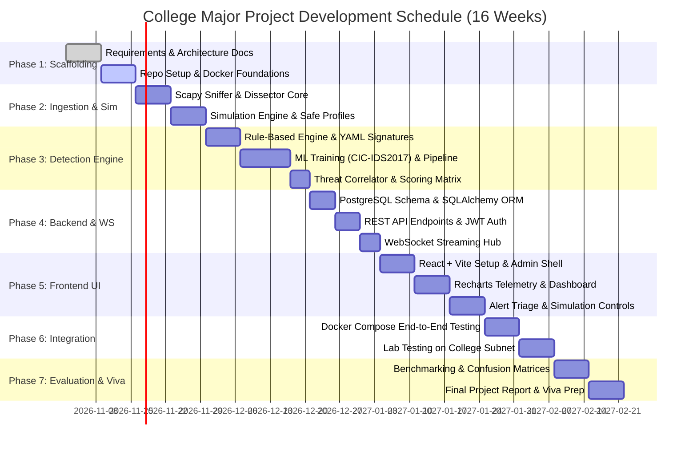

# Development Roadmap & Milestone Plan

**Project Name:** Campus Cybersecurity Threat Detection System  
**Document Version:** 1.0.0  
**Target Duration:** 16 Weeks (Standard College Major Project Semester Timeline)  
**Methodology:** Agile-Iterative with Dual-Week Sprints  

---

## 1. Project Phase Timeline & Gantt Representation

---

## 2. Phase-by-Phase Deliverables & Sprints

### Phase 1: Specifications & Environment Scaffolding (Weeks 1 – 2)
- **Sprint Goal:** Establish repository structure, architecture blueprints, and Docker development container foundations.
- **Key Tasks:**
  - Complete PRD, System Architecture, Database Schema, and API specifications.
  - Initialize Git repository with `backend/`, `frontend/`, `docs/`, and `docker/`.
  - Author `docker-compose.yml` defining PostgreSQL and service stubs.
  - Setup Poetry/Pipenv or `requirements.txt` for Python and `package.json` for React.
- **Deliverable:** Working Docker container launching an empty FastAPI server and empty React app connected to PostgreSQL.

---

### Phase 2: Network Ingestion & Traffic Simulation (Weeks 3 – 4)
- **Sprint Goal:** Capture network packets reliably and build the synthetic attack generator.
- **Key Tasks:**
  - Build Scapy `AsyncSniffer` wrapper with configurable interface and BPF filters.
  - Implement `dissector.py` to extract L3/L4 headers and strip L7 payloads.
  - Implement bidirectional `flow_aggregator.py` with sliding 5-second window.
  - Build `traffic_generator.py` with TCP SYN Flood, Port Scan, DNS Tunnel, and Benign traffic profiles.
  - Implement `guardrails.py` to enforce subnet whitelisting and rate capping.
- **Deliverable:** CLI demonstration capturing packets from loopback while injecting synthetic SYN flood and displaying extracted flow statistics in terminal.

---

### Phase 3: Dual Detection Engine (Rules + ML) (Weeks 5 – 7)
- **Sprint Goal:** Implement signature rule evaluation and train Scikit-learn models.
- **Key Tasks:**
  - Design YAML signature schema (`rules/signatures.yaml`) for SYN floods, scans, and malicious ports.
  - Build deterministic rule evaluation engine (`evaluator.py`).
  - Preprocess CIC-IDS2017 / NSL-KDD datasets; select 18 flow features.
  - Train and evaluate `RandomForestClassifier` (Multi-class: Benign, DoS, Scan, BruteForce).
  - Train and evaluate `IsolationForest` (Unsupervised zero-day anomaly detection).
  - Build `correlator.py` combining rule matches and ML probabilities into a unified threat score.
- **Deliverable:** Serialized model artifacts (`.joblib`) with $> 94\%$ validation accuracy and working hybrid correlator pipeline.

---

### Phase 4: Backend API, Persistence & WebSockets (Weeks 8 – 9)
- **Sprint Goal:** Connect detection engine to PostgreSQL and stream events to clients.
- **Key Tasks:**
  - Write SQLAlchemy ORM models and generate initial Alembic migration.
  - Implement JWT authentication with Argon2id password hashing.
  - Implement REST routes: `/api/v1/auth`, `/api/v1/alerts`, `/api/v1/simulation`, `/api/v1/dashboard`.
  - Implement FastAPI WebSocket manager broadcasting 1-second telemetry heartbeats and immediate threat alerts.
- **Deliverable:** Interactive Swagger UI (`/docs`) where endpoints can be tested and WebSocket messages can be inspected.

---

### Phase 5: React Frontend Dashboard & Visualizations (Weeks 10 – 12)
- **Sprint Goal:** Build the single-pane-of-glass administrative interface.
- **Key Tasks:**
  - Configure Tailwind CSS, Lucide-react icons, and Vite build pipeline.
  - Create administrative layout with sidebar, connection pill, and auth guards.
  - Integrate Recharts:
    - Real-time Area Chart for network throughput (KB/s, Packets/s).
    - Protocol distribution Donut Chart.
    - Threat category Bar Chart.
  - Build Alert Triage Table with filtering, pagination, and evidence modal.
  - Build Simulation Control Panel with attack profile cards, rate sliders, and Emergency Abort button.
- **Deliverable:** Fully functional React dashboard receiving live WebSocket feeds and displaying real-time threat charts.

---

### Phase 6: System Integration & Lab Testing (Weeks 13 – 14)
- **Sprint Goal:** End-to-end testing in simulated and authorized college lab network environments.
- **Key Tasks:**
  - Run end-to-end Docker Compose setup on examiner/demonstration machines.
  - Test Pure Simulation Mode (100% offline, single laptop).
  - Test Authorized Live Monitoring on a designated departmental lab switch port.
  - Validate safety guardrails: ensure attempts to simulate against public IPs are blocked.
  - Tune rule thresholds and ML confidence gates to minimize false alarms on lab background traffic.
- **Deliverable:** Stable, repeatable end-to-end demonstration script.

---

### Phase 7: Evaluation, Benchmarking, Report & Viva Prep (Weeks 15 – 16)
- **Sprint Goal:** Academic documentation, thesis report, and presentation readiness.
- **Key Tasks:**
  - Generate performance benchmark figures:
    - Detection latency (ms per flow).
    - CPU & memory consumption under 2,000 packets/second load.
    - Confusion matrix, precision, recall, F1-score, and ROC-AUC curves for academic report.
  - Compile final Major Project Report following university formatting guidelines.
  - Prepare demonstration slides and rehearse live defense (highlighting hybrid design, real-time WebSockets, and safety controls).
- **Deliverable:** Final Project Report, slide deck, and polished live demonstration.

---

## 3. Academic Evaluation Readiness & Risk Matrix

| Risk / Challenge | Probability | Impact | Mitigation Strategy |
| :--- | :-: | :-: | :--- |
| **Examiner laptop lacks Npcap / raw capture rights** | High | High | Implement **Pure Simulation Mode** using loopback so the system can run seamlessly without special drivers or network permissions. |
| **High packet loss at high traffic rates** | Medium | Medium | Use BPF kernel filtering to strip non-IP/irrelevant frames; decouple capture from ML inference using async queues. |
| **ML false positives on benign student traffic** | Medium | Medium | Weight deterministic rules ($w_r = 0.50$) higher than ML ($w_m = 0.35$); provide simple UI toggle to tune sensitivity. |
| **Simulations disrupting real college network** | Low | Critical | Hardcoded destination IP whitelist strictly blocking non-private/non-loopback IP ranges; atomic Emergency Stop button. |
| **Database growth filling college PC storage** | High | High | Never store raw packet payloads; store 5-second flow summaries and alerts only; daily automated retention purge. |
